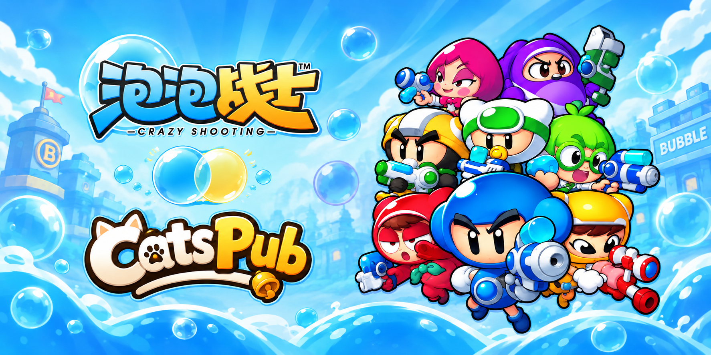

<div align="center">



# BubbleFighter Launcher

**面向 BubbleFighter 客户端的 Windows Electron 启动器**

账号注册与登录 · 服务器管理 · 加密登录记录 · 游戏启动


[](https://github.com/K1roSama/BubbleFighter_Launcher/actions/workflows/ci.yml)
[](https://github.com/K1roSama/BubbleFighter_Launcher/releases/latest)
[](LICENSE)


[下载最新版本](https://github.com/K1roSama/BubbleFighter_Launcher/releases/latest) · [快速上手](#快速上手) · [构建指南](docs/build.md) · [使用说明](docs/usage.md)

<table aria-label="community">
<tr>
<td align="center" width="280">
  <a href="https://qm.qq.com/q/fAcNMJVyuI">
    <br />
    <strong>加入 泡泡战士 K1ro 服社区</strong>
  </a>
</td>
<td align="center" width="280">
  <a href="https://afdian.com/a/K1roSama1337">
    <br />
    <strong>通过 爱发电 支持我们！</strong>
  </a>
</td>
<td align="center" width="280">
  <a href="https://ko-fi.com/k1rosama">
    <br />
    <strong>请我们喝杯咖啡！</strong>
  </a>
</td>
</tr>
</table>

---

<table aria-label="CatsPub AI">
<tr>
<td align="center" width="840">
  <a href="https://catspub.com">
    <br />
    <strong>本项目由 Catspub 中转站获得支持</strong>
  </a><br />
  <sub>稳定 · 快速 · 用户至上</sub>
</td>
</tr>
</table>

</div>

## 项目介绍

这是一个面向兼容 BubbleFighter 客户端与登录服务的桌面启动器。界面使用 Electron，网络登录与游戏启动由主进程处理，支持账号注册、登录、服务器切换、客户端选择、明暗主题及登录记录恢复。

**本仓库只提供启动器，不包含游戏客户端、登录适配器、游戏服务端或数据库。** 游戏内登录需要客户端支持 `BF_LOGIN_TICKET` / `BF_LOCAL_NAME`，服务端支持本项目的注册、登录和一次性票据协议；不能直接连接官方账号系统。

| 功能 | 当前实现 |
| --- | --- |
| 账号操作 | 注册、密码确认、登录、退出登录与中文错误提示 |
| 服务器管理 | 内置泡泡一区、自定义 IPv4 地址与端口、服务器选择与删除自定义条目 |
| 登录记录 | Windows DPAPI 加密保存，按安装目录与普通／多开会话隔离 |
| 游戏启动 | 选择客户端 EXE、启动前重新获取一次性票据、Windows 原生进程创建回退 |
| 运行状态 | 检查已运行的游戏，游戏运行时锁定服务器与客户端设置 |
| 独立登录服务 | 支持服务端返回独立游戏／家族端点，同时兼容原单端点响应 |
| 界面 | 独立登录、注册、服务器及设置页面，启动画面与明暗主题 |
| 多开辅助 | 附带针对特定 32 位客户端构建的原生多开器，详见[使用限制](#使用限制) |

## 快速上手

1. 从 [Releases](https://github.com/K1roSama/BubbleFighter_Launcher/releases/latest) 下载 `BubbleFighterLauncher-v版本号-win32-x64.zip`。
2. 将 ZIP **完整解压到游戏根目录**，使 `GameLauncher.exe` 与游戏 EXE 位于同一层。保留压缩包中的完整目录结构。
3. 双击 `GameLauncher.exe`，在设置中选择游戏客户端及服务器，然后注册或登录账号。
4. 登录后选择服务器并启动游戏。默认客户端文件名为 `BubbleFighterU.exe`，其他路径需在设置中选择。

```text
游戏根目录/
├── GameLauncher.exe
├── BubbleFighterU.exe                 # 自行准备的客户端
├── launcher/
│   └── dist/BubbleFighterLauncher-win32-x64/
│       ├── BubbleFighterLauncher.exe
│       ├── resources/app.asar
│       └── resources/app.asar.unpacked/native/GameProcess.exe
└── local_server/native/build/multi_client.exe
```

普通用户无需安装 Node.js、Python、Visual Studio 或数据库。不能只复制一个 EXE；Electron 运行库和 `resources` 目录也必须保留。默认登录地址为 `127.0.0.1:7100`，可在设置中添加自己的服务器；内置地址的可用性取决于对应服务端。

## 构建与部署

| 项目 | 要求 |
| --- | --- |
| 系统 | Windows x64；建议 Windows 10 / 11 |
| JavaScript 工具链 | Node.js 24 LTS 与 npm，使用 `package-lock.json` 固定依赖 |
| 界面与打包 | Electron 44.11.3、Tailwind CSS 4.3.3、Electron Packager 20.3.0 |
| C# 辅助程序 | Windows 自带的 .NET Framework 4.x 编译器 |
| 多开器 | Visual Studio 2022 或更新版本的 MSVC x86 工具链与 Windows SDK |

```powershell
git clone https://github.com/K1roSama/BubbleFighter_Launcher.git
cd .\BubbleFighter_Launcher
npm ci --prefix launcher
powershell -NoProfile -ExecutionPolicy Bypass -File .\scripts\build-release.ps1
```

构建结果位于 `release/`，包括可分发 ZIP 和 `SHA256SUMS.txt`。开发运行、原生工具链配置与 CI 发布流程见[构建指南](docs/build.md)。

## 使用限制

- **客户端与服务端兼容性**：启动器不提供客户端补丁，也不保证所有地区、版本或登录服务兼容。客户端必须能消费启动器签发的一次性登录票据。
- **网络协议**：当前注册／登录通过自定义 TCP 协议通信，没有 TLS 传输层加密。DPAPI 保护的是本机登录记录，不能替代网络传输加密。
- **配置与登录记录**：`launcher/settings.json` 保存服务器、账号名与偏好；密码加密存放在当前 Windows 用户的应用数据目录，一次性票据不保存到设置文件。
- **连接文件**：启动前会更新所选客户端目录的 `login.ini`，首次覆盖已有内容时保留 `login.ini.launcher-backup`。
- **多开器**：仅接受源码中校验的 32 位客户端镜像；不兼容时拒绝启动。它不是通用多开工具，不代表其他客户端版本已完成验证。
- **发布包**：当前提供 Windows x64 便携包，无安装器、自动更新或代码签名。

## 文档与贡献

| 文档 | 内容 |
| --- | --- |
| [构建指南](docs/build.md) | 工具链、开发运行、打包、CI 与版本发布 |
| [使用说明](docs/usage.md) | 服务器、客户端、登录记录、独立登录模式与多开 |
| [配置示例](launcher/settings.example.json) | 默认配置字段，不含密码与登录票据 |
| [更新记录](CHANGELOG.md) | 版本变化 |
| [第三方声明](THIRD_PARTY_NOTICES.md) | Electron、图标和品牌素材说明 |

欢迎通过 [Issues](https://github.com/K1roSama/BubbleFighter_Launcher/issues) 反馈问题或提交 Pull Request。反馈时请附上启动器版本、Windows 版本、客户端版本和复现步骤；提交日志前请移除密码、账号隐私及登录票据。

## 许可证

本项目源码使用 [MIT License](LICENSE)。Electron、图标和品牌素材的许可与归属见[第三方声明](THIRD_PARTY_NOTICES.md)。
